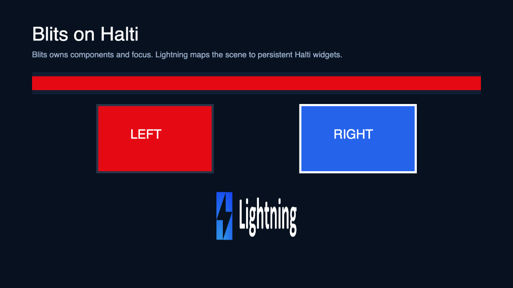

# Experimental Halti renderer

This branch explores a **Lightning 3 renderer backend for Halti**, proven with a
real [Blits](https://lightningjs.io/v3-docs/blits/) application.

The division of responsibility is intentional:

```text
Blits components, reactivity, focus, and input
  -> Lightning CoreNode scene
  -> experimental HaltiRenderer
  -> supplied Gibbon/Halti widgets
```

This is a renderer backend for Lightning 3, not a fork of Blits and not an
NRDP host architecture. The host initializes Halti, provides an existing root
widget, and supplies a widget factory and optional frame-completion boundary.

## Running the browser proof

```bash
pnpm install
pnpm build
pnpm --dir examples build
pnpm start
```

Open:

```text
http://localhost:5173/?app=blits-halti
```

The example uses Blits components and focus navigation. Its browser-only DOM
driver implements the same structural property contract as Gibbon widgets so
the scene graph and lifecycle can be inspected without NRDP. It is **not** a
Halti implementation and is not performance evidence.



## Supplying real Gibbon widgets

```ts
import { CanvasTextRenderer } from '@lightningjs/renderer/canvas';
import { HaltiRenderer } from '@lightningjs/renderer/halti';

Blits.Launch(App, target, {
  w: 1920,
  h: 1080,
  renderMode: 'canvas', // Blits default selection; overridden below.
  canvas: hostCanvas,
  advanced: {
    renderEngine: HaltiRenderer,
    fontEngines: [CanvasTextRenderer],
    halti: {
      root: hostHaltiRoot,
      createWidget: () => nrdp.gibbon.makeWidget({}),
      ensureFrameRendered: () => Halti.ensureFrameRendered(),
    },
  },
});
```

The renderer package deliberately uses a structural `HaltiWidget` interface
instead of importing NRDP declarations. The real objects only need to satisfy
that interface.

## What the spike supports

- stable widget identity across Lightning frames;
- Blits component, reactivity, focus, and input behavior;
- solid-color quads;
- image and Canvas-text textures;
- translation, scale, rotation, opacity, visibility, and draw order;
- rectangular clipping;
- stale-node removal and deterministic teardown;
- an optional `ensureFrameRendered()` completion boundary;
- texture-memory accounting for converted Canvas images.

Each renderable Lightning node owns a persistent wrapper/content widget pair.
The wrapper provides global rectangular clipping and ordering; the content
widget owns the visual and transform. Nodes omitted from a later frame are
destroyed.

## Deliberate gaps

The spike does not yet claim support for:

- physical-device/Jamba validation;
- Lightning custom shaders or effect graphs;
- exact four-corner gradients;
- exact skew transforms;
- rounded clipping;
- render-to-texture;
- native Halti text or direct NRDP image resources;
- renderer-attributed Halti/GPU telemetry;
- device-loss recovery semantics.

Canvas text and browser images are currently converted to data URLs. That is a
portable proof mechanism, not the desired production resource path for NRDP.
A physical-device follow-up should replace it with native Halti text/image
plumbing and verify lifecycle, focus, clipping, and frame completion on Jamba.

## Falsification criteria for the next step

Before treating this as a production direction, a Jamba proof should show:

1. the Blits example mounts through actual Gibbon widgets;
2. focus changes update without rebuilding unchanged widgets;
3. image/text resources survive repeated mount/dispose cycles;
4. rectangular clipping and transforms match the Lightning scene;
5. `Halti.ensureFrameRendered()` provides a usable completion boundary;
6. retained resources plateau after repeated teardown;
7. missing shaders/effects can be bounded or explicitly redesigned.
